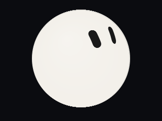

# Grok Bot

把 [grok-ball](https://github.com/tycoding/grok-ball) 的 Grok 小球表情动画移植到 **HoloCubic**（320×240 横屏 / Lua + LVGL）的前台应用。

纯 Lua 实现，不需要编译，也不依赖任何图片素材——球体、眼睛、睡眠字母、撒花全部在 LVGL canvas 上逐帧实时绘制。启动后按 `00 → 01 → … → 41 → 00` 的顺序循环播放全部 32 套表情，每个停 5.2 秒，一圈约 2.8 分钟。

球体默认直径 192px（占屏高 80%），径向渐变 16 级、球缘与眼缘逐像素抗锯齿，所以在 320×240 的屏上仍然是一颗干净利落的小球。



## 功能

### 32 套表情

| 分组 | 编号 | 数量 |
| --- | --- | --- |
| 生命周期 | 00 睡眠 · 01 唤醒 · 02 待机放空 · 03 好奇 · 04 发呆 · 05 加载苏醒 · 06 休眠 · 07 抖动唤醒 | 8 |
| 情绪反应 | 10 开心 · 11 疑惑 · 12 失落 · 13 惊讶 · 14 害羞 · 15 疲惫 · 16 专注 · 17 慌张 · 18 无奈 · 19 满意 · 20 困惑 · 21 生气 | 12 |
| 代理状态 | 30 思考中 · 31 接收任务 · 32 处理中 · 33 任务完成 · 34 出错 · 35 等待输入 · 36 联网加载 · 37 复述回忆 · 38 拒绝 · 39 输出回复 · 40 检索资料 · 41 停止终止 | 12 |

### WorkBuddy 状态联动

小球可以实时显示 **WorkBuddy（AI 编程助手）** 的工作状态，设计文档见 [`grok.bot.status.md`](grok.bot.status.md)。

链路：WorkBuddy 会话轨迹（`~/.workbuddy/projects/`）→ PC 上运行的状态监控服务（`wb_status_pc/monitor-server.mjs`）→ 设备每秒轮询 `GET /api/holo` → 切换表情。

| WorkBuddy 状态 | 表情 | 附加动效 |
| --- | --- | --- |
| `idle` 空闲 | 02 待机放空 | 2 分钟后 06 休眠、5 分钟后 00 睡眠 |
| `thinking` 推理 | 30 思考中 | — |
| `working` 执行 | 32 处理中忙碌 | 进入时自旋一圈；detail 含"检索/搜索/抓取"切 40、含"规划任务"切 30 |
| `standby` 回复完等你 | 33 任务完成 **闪现 2.5s** → 35 等待输入 | 撒彩带 + 弹跳，之后每 8s 弹跳提醒 |
| `error` 出错 | 34 出错 | — |
| 会话切换 | 31 接收任务 闪现 1.5s | — |
| 服务不可达 | 36 联网加载一次后 | 自动降级回纯动画巡演 |

使用方法：

1. PC 上启动监控服务并开放局域网（首次会弹防火墙确认，点允许）：
   `HOST=0.0.0.0 node wb_status_pc/monitor-server.mjs`（或加 `--lan`）
2. `config.lua` 的 `wb_status.host` 填 PC 的局域网 IP，`port` 对应服务端口（默认 8788）。
3. 用户按键切表情后的 60 秒内状态不会抢屏幕（人工优先）；断链 3 次自动退回纯动画模式。
4. 诊断：状态跃迁记录在设备 `/sd/apps/grok_bot/status.txt`（`config.wb_status.log` 控制）。

### 动画机制

- **逐点弹簧形变**：25 组眼睛轮廓，每组左右各 48 个点。换眼神时不是直接替换图形，而是每个点各自用二阶弹簧追目标点，形变过程中会自然过冲、回弹。
- **球面投影**：眼睛位置按"经度"换算——把眼睛的水平偏移归一化成角度，加上自旋偏航后取正弦作为横向位移、余弦作为宽度压缩。越靠球边缘的眼睛越窄，绕球转动时会被挤出/挤入。
- **纵向拟合**：眼睛越靠近球的上下两极，垂直方向压得越扁，贴合球面曲率。
- **眨眼**：带关键帧队列（闭合 50ms → 过冲张开 1.08 → 回落），弹簧驱动，14% 概率连眨两下。部分表情关闭眨眼（如睡眠）。
- **呼吸**：默认振幅 0.01 的缩放 + 纵向漂移，相位走绝对时间，切换表情不会跳变。
- **眼神漂移**：常态下两只眼睛有不同相位的正弦微动，靠得住的"活着"感主要来自这里。
- **自旋**：弹簧追整数圈（±2π），自旋期间余弦压缩会把两只眼睛甩到球体侧面，形成明显的 3D 滚动感。
- **弹跳**：4 段高度递减的抛物线（48 → 28 → 14 → 6）。
- **过渡**：换表情时新旧姿态用 `easeInOutCubic` 混合，时长由表情的 `transition` 决定（320~900ms）。
- **关键帧序列**：部分表情（如 01 唤醒）走脚本化关键帧，结束后可回落基础姿态（`settle='base'`）或自动切到下一个表情（`settle={next=...}`）。
  - 巡演（`autoplay=true` 的顺序轮播）期间会关掉 `settle={next}`，改成停在末帧等巡演自己往下走。否则 `01`/`07` 收尾会跳到 `02`，巡演走到第 8 个表情就被打回第 3 个、永远到不了 `10`~`41`。
  - 巡演用显式游标 `APP.tour_idx` 推进，不依赖"当前表情 id"，所以即使表情被手动/自动切走，顺序依然线性。
- **睡眠字母**：`00 睡眠` 时三枚 `z` 错峰沿右上漂移，先淡入后淡出。
- **撒花**：`33 任务完成` 进入时喷 20 片彩色纸屑（阻力 + 重力 + 旋转 + 淡出）。

### 画面精细度

`config.antialias = true`（默认）时：

- **径向渐变 16 级**：球体自球缘向内叠 16 层内接圆，色阶差 ≤1 个色值，取代旧版 5 层的大色带；渐变中心按原版 SVG 径向渐变偏向左上（`-0.30R, -0.42R`）。
- **球缘抗锯齿**：逐行算出圆的真实边界，把边界那一个像素按覆盖率与背景混色（`lv_canvas_set_px_color`，每帧约 400 次），上下两极的行再叠一层纵向覆盖率。几何用与 `draw_rect` 相同的整数量化结果，否则会差半像素、在球缘留下孤立亮点。
- **眼缘抗锯齿**：扫描线填充时左右边界各 1 个像素按水平覆盖率混色，首末行再乘纵向覆盖率；混色目标是眼睛中点处的球面底色（同色系，误差不可见），覆盖率量化成 16 级查表，每帧约 250 次 `set_px_color`。

关掉 `antialias` 会退回逐行整数端点填充（边缘有 1px 台阶），可省 3~4ms/帧。

## 按键

| 按键 | 作用 |
| --- | --- |
| `←` / `→` | 上一个 / 下一个表情（循环） |
| `↑` | 自旋一圈 |
| `↓` | 弹跳 |
| `HOME` | 退出应用 |

默认开启轮播（`autoplay = true`）：启动即从 `00` 开始按顺序循环。按方向键可随时手动跳转，跳过去之后新表情同样停满一个周期再继续往下走。把 `autoplay` 设为 `false` 则回到「15 秒无操作才开始轮播」的行为。

## 安装

设备上的目标目录是 `/sd/apps/grok_bot/`，**`package/` 里的文件要平铺进去**（`app.info` 必须在目录第一层）：

```
/sd/apps/grok_bot/
├── app.info
├── config.lua
├── grok_ball.lua
├── grok_data.lua
├── grok_engine.lua
├── main.lua
└── main.png
```

三种方式任选：

**1. 文件管理器上传**：打开 `http://<设备IP>/` 里的文件管理（或 DevTools 页面），把 `package/` 里的 7 个文件上传到 `/sd/apps/grok_bot/`。

**2. HTTP API 上传**（脚本化部署）：

```bash
DEV=192.168.0.109
cd package
for f in app.info config.lua grok_data.lua grok_ball.lua grok_engine.lua main.lua main.png; do
  curl -X PUT --data-binary @"$f" \
    "http://$DEV/api/system/fs/upload?path=/sd/apps/grok_bot/$f&offset=0&total=$(wc -c < $f)"
done
curl -X POST "http://$DEV/devtools/api/apps/rescan"   # 让 launcher 重新扫描
```

**3. 直接拷 SD 卡**：把 `package/` 的内容拷到 SD 卡的 `apps/grok_bot/`，插回设备上电。

装好后重启设备（或在 DevTools 里点 rescan），launcher 里会出现「Grok 小球 / Grok Bot」，图标是浅色小球配一双圆眼。

**卸载**：删掉 `/sd/apps/grok_bot/` 整个目录再 rescan。

## 配置

改 `config.lua` 后重启应用生效：

| 字段 | 默认 | 说明 |
| --- | --- | --- |
| `cx` / `cy` | `160` / `116` | 球心在屏幕上的位置 |
| `radius` | `96` | 球半径（像素），球直径 = `2*radius`，默认 192px |
| `bg` | `0x0B0C10` | 背景色 |
| `interval` | `33` | 重绘间隔 ms（≈30fps） |
| `antialias` | `true` | 球缘 / 眼缘逐像素混色；关掉省 3~4ms/帧，但边缘有台阶 |
| `bounce_scale` | `nil` | 弹跳高度系数；`nil` = 按 `radius` 与 `cy` 自动算，保证跳起来不出屏 |
| `autoplay` | `true` | 启动即按顺序循环播放全部表情 |
| `start_emotion` | `"00"` | 轮播起点 id |
| `fallback_emotion` | `"02"` | id 找不到时的回退表情 |
| `tour_step` | `5200` | 每个表情停留多久（ms），32 个一轮约 2.8 分钟 |
| `tour_delay` | `15000` | 仅 `autoplay = false` 时生效：无操作多久后开始轮播（ms） |
| `hint` | `<> switch   ^ spin   v bounce` | 启动时底部提示文字，4.5 秒后自动换成 `当前 id / 32` |
| `wb_status.enabled` | `true` | WorkBuddy 状态联动总开关；`false` 或 host 为空时纯动画 |
| `wb_status.host` | — | 状态监控服务所在 PC 的局域网 IP |
| `wb_status.port` | `8788` | 状态监控服务端口 |
| `wb_status.poll_ms` | `1000` | 轮询间隔 |
| `wb_status.log` | `true` | 状态跃迁写 `status.txt`（诊断用） |
| `snapshot_ms` | `nil` | 调试：设为毫秒数，启动后把屏幕导出为 `shot.png` |
| `perf_log` | `false` | 调试：每 `perf_frames` 帧往 `perf.txt` 写一行 fps |
| `perf_frames` | `200` | 调试：性能统计窗口帧数 |


## 目录结构

GitHub 发布仓库（holocubic_grok）以本 app 为根，另含 PC 侧配套服务：

```
holocubic_grok/
├── package/            # 需要部署到设备的内容
│   ├── app.info        # 应用元信息（名称、分类、入口、图标）
│   ├── config.lua      # 用户配置
│   ├── main.lua        # 应用外壳：canvas、主循环、按键、巡演、WorkBuddy 状态接入
│   ├── grok_engine.lua # 驱动层：姿态合成、弹簧、眨眼、表情池、序列、过渡
│   ├── grok_ball.lua   # 绘制层：球体、球面投影眼睛、zzz、撒花
│   ├── grok_data.lua   # 生成数据：25 组眼环 + 32 套表情（42KB）
│   ├── wb_status.lua   # WorkBuddy 状态轮询：/api/holo → 表情映射/闪现/降级
│   └── main.png        # 128×128 图标
├── scripts/
│   ├── gen_data.mjs    # 从上游 grok-ball.js 抽取几何/情绪数据生成 grok_data.lua
│   ├── gen_icon.py     # 生成图标
│   ├── preview.mjs     # 离线预览：Node + fengari 跑真实渲染代码，导出 PNG
│   ├── preview_canvas.lua  # 预览用的 canvas 打桩实现（纯 Lua 光栅化）
│   ├── preview_driver.lua  # 预览驱动脚本
│   ├── tour_driver.lua     # 巡演调度回归驱动（--tour）
│   └── wb_driver.lua       # WorkBuddy 状态机回归驱动（--wb）
├── wb_status_pc/       # PC 侧 WorkBuddy 状态监控服务（配套，见 grok.bot.status.md）
├── sync.sh             # 从开发工作区同步最新代码到本仓库
├── grok.bot.status.md  # WorkBuddy 状态联动设计文档
├── grok.bot.design.md  # 语音对话设计稿
├── preview.png
└── README.md
```

## 实现要点

LVGL 的 canvas 没有"填充多边形"图元，而眼睛是 48 点闭合轮廓。这里的做法是：

1. 在世界坐标（viewBox 259×259，头部中心 114.27，半径 114.27）里把眼环做完整仿射变换；
2. 用**扫描线**把多边形按行拆成水平线段，每帧每只眼睛约 40~60 次 `lv_canvas_draw_line`；
3. 边界像素用 `lv_canvas_set_px_color` 按覆盖率混色（抗锯齿）；
4. 整体再缩放到屏幕（球半径 96px）。

球体用 `radius = LV_RADIUS_CIRCLE` 的圆角矩形做底（暗边 + 主体），再叠 16 层内接圆近似 SVG 的径向渐变，最后逐行修一遍球缘。

热路径（每帧）不分配新表：姿态表、眼环缓冲、扫描线交点数组、抗锯齿混色查表都是预分配的，只有换表情时才创建 2 个 96 元素数组。

## 性能

旧版（`radius=84`、`antialias=false`）在 HoloCubic（ESP32-S3）上实测：

```
fps = 30.0   每帧 16.9ms
  engine  2.2ms   姿态合成 / 弹簧 / 序列
  canvas 14.2ms   bg 0.2  球体 0.9  眼睛 12.9  其他 0.2
```

现在的默认配置是 `radius=96` + 抗锯齿：球体填充面积约 2.4 倍（0.9 → ~2ms），另加约 650 次 `set_px_color`（球缘 ~400 + 眼缘 ~250，离线渲染器实测计数）。整体预计比上表多 3~5ms/帧，仍在 33ms 的重绘间隔内；真机上请打开 `config.perf_log` 看 `perf.txt` 里的 `fps / cost / canvas bg body eye fx` 一行确认。

瓶颈仍然是眼睛填充（每次 `draw_line` 调用固定开销较大）。如果要提速，最直接的办法是把相邻两行合并成 2px 粗的线段，可省约 4ms，代价是眼缘略粗糙；或者直接 `antialias = false`。`config.interval` 调到 40 会更省电（约 25fps）；调到 25 反而不会更快——单帧的绘制时间加上 LVGL 刷新时间已经超过 25ms。

## 重新生成数据

`grok_data.lua` 是从上游 `grok-ball/src/grok-ball.js` 的数据段自动生成的，不要手改。上游改动后这样重新生成（需要 Node.js）：

```bash
node scripts/gen_data.mjs /path/to/grok-ball/src/grok-ball.js
python3 scripts/gen_icon.py /path/to/grok-ball/src/grok-ball.js   # 需要 Pillow
```

两个脚本都支持省略参数——此时会去 `../../grok-ball/src/grok-ball.js` 找（即与本仓库同级放置 grok-ball 源码的布局）。

## 离线预览

没有板子也能看画面：`scripts/preview.mjs` 用 Node + [fengari](https://github.com/fengari-lua/fengari)（Lua 5.3 的纯 JS 实现）跑 `package/` 里**真正的** `grok_ball.lua` / `grok_engine.lua`，只把 canvas 接口换成 `preview_canvas.lua` 里的纯 Lua 光栅化实现，输出 1:1 的 320×240 PNG（不做超采样，所以看到的就是设备观感）。

```bash
npm install fengari            # 一次性
node scripts/preview.mjs --emotion=10 --frames=40 --out=shot.png
node scripts/preview.mjs --emotion=14 --frames=25 --aa=0     # 关掉抗锯齿对比
node scripts/preview.mjs --emotion=02 --frames=7 --action=bounce --at=1   # 抓弹跳最高点
```

可选参数：`--emotion=<id>`、`--frames=<n>`、`--dt=<ms>`、`--aa=0|1`、`--action=spin|bounce --at=<frame>`。

另外还能端到端验证调度（会真的加载 `package/main.lua`，用打桩的 `tmr`/`millis`/`http` 推时钟，只跳过像素绘制）：

```bash
node scripts/preview.mjs --tour=400     # 巡演回归：模拟 400 秒，打印每个表情出现的时间点
node scripts/preview.mjs --wb=45        # WorkBuddy 状态机回归：剧本驱动全部状态跃迁/闪现/离线降级
```

`--tour` 正常输出应是 `00 01 02 … 07 10 … 41 00 …` 严格按顺序、每个约 5.2 秒、跑满 32 个再从头开始；`--wb` 应输出 13 步表情轨迹并以 `PASS` 结束。

## 与原版的差异

- 未实现原版的**彩带拖尾**（`ribbons` / trails）和**头顶环绕**（`orbit`），其余动画机制均已移植。
- 原版用 SVG 径向渐变画球体，这里用 16 层内接圆离散近似，正常观看距离下无分层；放大到像素级仍能看出极轻微台阶。
- SVG 的抗锯齿是矢量光栅化，这里是在 canvas 上手工做覆盖率混色：球缘与眼缘平滑，但 `zzz` 文字和撒花仍是硬边。

## 致谢与许可

眼环几何与 32 套表情数据、动画算法均来自 **grok-ball**（MIT License, Copyright (c) 2026 tycoding），原始许可见 [`LICENSE-grok-ball`](LICENSE-grok-ball)。本移植同样以 MIT 协议发布。
